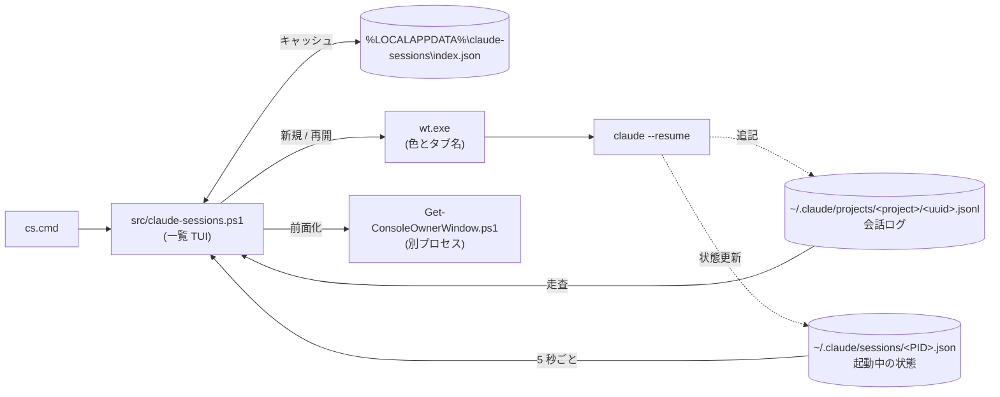

# Claude Code Session Manager

[English](README.md) | 日本語

Claude Code CLI の全セッションを一覧して絞り込み、再開できる Windows 用ランチャー。
起動中のセッションのうち、どれがユーザーの操作を待っているかも示す。

複数プロジェクトで Claude Code のセッションを並行して使っていると、どのターミナルがどの作業のものか分からなくなる。
このツールは `~/.claude/projects` 配下の全セッションを一覧表示し、選んだセッションを `claude --resume` して開く。
開いたセッションは Windows Terminal の 1 つのウィンドウにタブとして並ぶ。
タブの色とタイトルはプロジェクトごとに変わるので、どのタブが何の作業か一目で分かる。

## 特徴

- **起動中の状態表示**：起動中のセッションに `稼働中`、`応答待ち`、`完了` を表示し、5 秒ごとに更新する。
- **二重起動の防止**：起動中のセッションで `Enter` を押すと、2 つ目を開かずにそのセッションのタブに切り替えて前面に出す。
  手で起動した `claude` も対象になる (こちらはウィンドウの前面化まで)。
- **1 ウィンドウにタブで集約**：セッションごとにウィンドウを増やさず、専用のウィンドウ 1 つにタブで開く。
  設定でセッションごとに別ウィンドウで開く方式にも戻せる。
- **プロジェクト別のタブ色**：プロジェクトごとに常に同じタブ色とタイトルが付く。
  Windows Terminal のプロファイル設定は要らない。
- **ごみ箱への削除**：`Ctrl+D` はセッションをごみ箱に送るので、誤って消しても戻せる。
  起動中のセッションは削除しない。
- **インストール不要**：Windows 標準の Windows PowerShell 5.1 でも PowerShell 7 でも動くスクリプトで、clone して `cs.cmd` を実行すれば使える。
- 全プロジェクトのセッションを 1 つの画面で扱う (`claude --resume` は現在のディレクトリの分しか出さない)。
  既定ではディレクトリごとに最新のセッションだけを新しい順に並べ、隠れた古いセッションの数を `(+N)` で示す。
  `Shift+Tab` で全セッションの一覧に切り替わる。
  セッション名とパスでインクリメンタル検索でき、空白で区切った複数語は AND で絞り込む。
- `Ctrl+N` で、選択中のプロジェクトに新しいセッションを始められる。
- `Ctrl+P` で、セッションを一覧の先頭に固定できる。固定した行には `*` が付く。
- UI は日本語と英語に対応する。

## 導入

次の 3 つが必要になる。
管理者権限は要らない。

- Windows PowerShell 5.1 (Windows 10 / 11 に標準で入っている) または PowerShell 7.4 以降。
  PowerShell 7 (`pwsh`) が入っていれば `cs.cmd` はそちらを使う
- Windows Terminal
- Claude Code CLI (`claude` が PATH 上にあること)

リポジトリを git clone し、フォルダ内の `cs.cmd` を実行すれば起動する。
どこからでも起動したい場合は、このフォルダを PATH に通す。

git clone ではなく ZIP でダウンロードした場合は、Windows がスクリプトに「インターネットから取得した」印を付けるため、既定の実行ポリシーでは実行を拒否される。
スクリプトの中身を確認したうえで、展開したフォルダで一度だけ次を実行して印を外す。

```powershell
Get-ChildItem -Recurse | Unblock-File
```

## 使い方

```powershell
.\cs.cmd
```

Git Bash からは `./cs.cmd` で起動する。

画面の言語は Windows の表示言語に合わせて日本語か英語になる。
固定したい場合は「設定」節の `Language` を変える。

初回起動時は全セッションの jsonl を走査するため数秒かかる。
2 回目以降は `%LOCALAPPDATA%\claude-sessions\index.json` のキャッシュを使うので、すぐに開く。
このキャッシュには詳細欄に出すため各セッションの最後の入力の先頭 300 文字も入るので、入力に貼った内容はここにも複製される。
ファイルは消してよく、次回起動時に作り直す。

一覧の先頭列には、起動中セッションにおける Claude Code の状態を表示する。
未起動のセッションは空欄になる。
ツールはこの状態を 5 秒ごとに読み直し、変わったときだけ描き直す。
間隔は設定の `RefreshIntervalMs` で変えられ、`0` にすると自動更新を止める。
止めた場合も、`Enter`、`Ctrl+D`、`Ctrl+R` を押したときは状態を読み直す。

一覧を開いている間に始まったセッション (`Ctrl+N` や手で起動したもの、`/clear` で ID が変わったもの) は、Claude Code が最初の発言を書き込んだ後の読み直しで一覧に加わる。
それ以外に自動で読み直すのは状態だけで、一覧そのものは読み直さない。
セッションの並び順と最終利用日は、起動時か `Ctrl+R` を押したときに一覧へ反映される。
ディレクトリ別の最新表示で、どのセッションを最新として残すかも同じタイミングで決まる。

| 表示 (英語) | 色 | 意味 |
| --- | --- | --- |
| `稼働中` (`Working`) | 緑 | Claude が処理中 (シェルコマンド実行中を含む) |
| `応答待ち` (`Waiting`) | 黄 | ツール実行の許可や質問への回答など、ユーザーの操作待ち |
| `完了` (`Done`) | 青 | ターンが終わり、次の入力待ち |
| `起動中` (`Running`) | 色なし | 起動中だが状態の値が未知 (Claude Code の更新で値が変わった場合など) |

一覧の下の「最後の入力」欄には、選択中のセッションで最後に入力したプロンプトを 2 行まで表示する。
開く前に、どこまで進めた作業かを確かめられる。
画面の高さが足りないときは、この欄を出さない。

### キー操作

| キー | 動作 |
| --- | --- |
| 文字を入力 | セッション名とパスの両方で絞り込む (インクリメンタル検索)。空白区切りで複数語を打つと AND 検索になる |
| `↑` / `↓` | 絞り込み結果の中を移動 (画面外へはスクロールする) |
| `PageUp` / `PageDown` | 1 画面分移動 |
| `Home` / `End` | 先頭 / 末尾へ移動 |
| `Enter` | 選択中のセッションを再開する。起動中ならそのタブに切り替えて前面に出す。バックグラウンドで動くセッション (`claude --bg`) は `claude attach` で新しいタブに開く |
| `Shift+Tab` | ディレクトリ別の最新表示と全セッション表示を切り替える。検索語と選択中のセッションは保持する。選んでいたセッションが切替後に隠れる場合は、同じディレクトリの最新の行を選ぶ |
| `Backspace` | 検索文字を 1 文字消す |
| `Esc` | 検索をクリア。検索が空のときは 2 回続けて押すと終了する |
| `Ctrl+C` | 強制終了 |
| `Ctrl+N` | 選択中のプロジェクトで新規セッションを開始する。始めたセッションは、最初の発言から数秒後に一覧に出る |
| `Ctrl+P` | 選択中のセッションを一覧の先頭に固定する。もう一度押すと解除する。固定した行は先頭に `*` が付き、他の行より上に最終利用日の順で並ぶ。ディレクトリ別の最新表示でも隠れない |
| `Ctrl+D` | 選択中のセッションをごみ箱に移動する。`y` で確定し、それ以外のキーで取り消す。起動中のセッションは削除できない |
| `Ctrl+R` | セッション索引を再構築する (キャッシュを無視して再走査)。検索語と選択中のセッションは保持する |

## 仕組み



実線はこのツールの処理、点線は Claude Code 自身の書き込みを表す。
このツールは Claude Code のファイルを読むだけで、書き込まない (例外は `Ctrl+D` によるごみ箱送り)。

### セッション索引とキャッシュ

索引は `~/.claude/projects/<プロジェクト>/<uuid>.jsonl` を 1 階層下まで走査して作る (`-Recurse -Depth 1`)。
サブエージェントの発話 (`<uuid>\subagents\agent-*.jsonl`) は、この深さ制限で除外される。
84MB クラスのログでも実用的な速度で読めるよう、型ごとの JSON パースを最小限にし、大半のフィールドは正規表現で直接抜き出している。
最後の入力は、Claude Code がファイル末尾付近に書く `last-prompt` レコードから取る。
大きなファイルでは末尾 128KB だけを探すため、レコードがそれより前にあるセッションはプレビューが空になる。

ファイルの更新日時とサイズが前回と一致するセッションは再走査しない。
変化が無ければ、キャッシュファイル自体も書き直さない。
最後の入力を記録していない旧版のキャッシュは、更新後の初回起動で一度だけ全セッションを読み直す。

初回起動と `Ctrl+R` による再構築では、キャッシュに無いセッションを実際に読むため、数百 ms 〜 数秒かかることがある。
その間は `[現在件数/全件数]` を画面に出す。

### タブの起動と色

既定 (`WindowMode = 'tabs'`) では、`wt -w cs new-tab` で `cs` という名前の専用ウィンドウにタブを足す。
ウィンドウが無ければ Windows Terminal が作る。
ウィンドウ名は `TabWindowName` で変えられる。
`WindowMode = 'windows'` にすると、従来どおりセッションごとに `cs-<セッション ID>` という名前の別ウィンドウで開く。

タブは `wt.exe` の起動引数 (`--title` / `--tabColor` / `-d`) で、プロジェクトごとの色とタブ名を直接指定して開く。
タブ方式では、同じプロジェクトのタブを区別できるよう、タブ名にセッション ID の先頭 8 桁を付ける (`claude_powershell #1a2b3c4d`)。
`--suppressApplicationTitle` を付けるので、シェルや claude がタイトルを書き換えてもタブ名は変わらない。
Windows Terminal のプロファイルは登録しないため、初めて開くプロジェクトでもすぐに色が反映される。
`settings.json` には一切触れない。

起動時には、Claude Code が子プロセスへ設定する環境変数 (`CLAUDE_CODE_*`、`CLAUDECODE`、`CLAUDE_PID`、`CLAUDE_EFFORT`) を取り除く。
このため、Claude Code のセッション内からこのツールを起動しても、開いたセッションが「他セッションの子」と誤認識されない。

色は作業ディレクトリのパスをハッシュして、固定パレットから決定的に選ぶ。
同じプロジェクトは常に同じ色になる。

作業ディレクトリが消えたセッションを開こうとした場合や、`wt.exe` の起動に失敗した場合は、ツールを終了させず、通知行 (検索行のすぐ下にある通知用の行) に理由を表示する。
jsonl は `FileShare.ReadWrite` で開くため、Claude Code が書き込み中のファイルでも共有違反にならない。

### 起動中セッションの検出と自動更新

Claude Code は起動中のセッションを `~/.claude/sessions/<PID>.json` に記録し、状態が変わるたびに `status` (`busy` / `shell` / `waiting` / `idle`) を書き換えている。
このツールはこの記録を読み、PID のプロセスが生きているものを起動中の候補とする。
さらに、プロセスの起動時刻とレコードの `procStart` を突き合わせ、一致するものだけを起動中とみなす。
異常終了で残った古いレコードを、PID を再利用した別プロセスが誤って引き継がないようにするためである。

このツールはキー入力をブロッキングで待たず、5 秒ごとに状態を読み直す。
`Enter` と `Ctrl+D` では、この間隔とは別に判定の直前に読み直す。
前回の読み込みの後に起動したセッションを未起動と見誤って新しく開くと、同じセッションに 2 プロセスが書き込んでしまう。
直前の読み直しは、これを防ぐためである。
`Enter` で開いた直後のセッションは、状態ファイルに記録されるまで数秒かかる。
記録されるまで (最長 30 秒、`LaunchGraceMs`) は、もう一度 `Enter` を押しても「起動処理中」と表示するだけで開かず、`Ctrl+D` も削除を拒否する。
`Ctrl+N` は、同じプロジェクトへの 3 秒以内 (`NewSessionGraceMs`) の連打を無視する。
状態ファイルの読み取りには cmdlet ではなく .NET の API を直接呼び、定常的に走る処理を軽くしている。

表示内容を決める入力 (検索語、選択位置、起動中セッションの状態など) から署名を作り、前回と同じなら画面の組み立て自体を省略する。
組み立てた場合も、前回と同じ文字列なら書き出さない。
描画は画面全体を消さず、カーソルを左上に戻して上書きする。
このため、状態が変わらない間は画面がちらつかない。
ウィンドウサイズの変化だけは自動更新の間隔と関係なく、0.1 秒以内に描き直す。

### 一覧の表示と検索

全角文字は画面上 2 桁を占めるため、列は文字数ではなく表示幅で揃えている。
日本語のセッション名やパスでも列がずれない。
セッション名の列は上限 40 桁とし、残りの幅はすべてパス列に回す。
ウィンドウを広げると、パスの省略が減っていく。

検索は、セッション名とパスの両方を大小の区別なく部分一致で探す。
空白区切りの複数語は、すべてに一致したものだけを残す。
`[` や `*` もそのままの文字として扱う。
一致した部分には下線を引く。状態の色と紛れないよう、色は変えない。
一致箇所がパスの省略された側にあるときは、その位置が見えるように表示範囲をずらす。

検索行は画面上部、タイトルの下に置き、常に実際の端末カーソルを置く。
件数が変わっても検索行の位置は動かない。
空のときは「文字を入力して絞り込み」とグレーで表示し、入力欄であることを示す。

### ディレクトリ別の最新表示

検索は全セッションに対して行い、一致したものの中から作業ディレクトリごとに最新の 1 件を残す。
以下では、この残した行を**代表行**と呼ぶ。
そのため、古いセッションの名前で検索してもそのディレクトリが見つかる。
大文字小文字、`/` と `\`、末尾の区切り文字だけが違うパスは同じディレクトリとみなす。

起動中のセッションは、最新でなくても一覧に残す。
応答待ちのセッションが隠れて見落とされないようにするためである。
並びは他の行と同じく最終利用日の順になる。

代表行のセッション名の後ろに付く `(+N)` は、そのディレクトリで検索に一致したうち表示していない件数である。
`Shift+Tab` で全件表示に切り替えたとき、そのディレクトリで増える行数と一致する。
セッション名が長くても `(+N)` は残し、名前の側を切り詰める。
起動時から全セッションを表示したい場合は、設定で `LatestPerDirectory = $false` にする。

件数は一覧の下の罫線の右端に、たとえば `表示 1-20 / 30 件 (全 93 件)` と出る。
`1-20` は画面に出ている範囲、`30` は今の表示の種類と検索語で絞り込んだ行数、`全 93 件` は全セッションの数である。
今の表示の種類 (`[ディレクトリ別 最新]` または `[全セッション]`) は、一覧の上の罫線の右端に示す。

ディレクトリ別の最新表示で `Ctrl+D` を押しても、ごみ箱に送るのは選んだ 1 セッションだけで、同じディレクトリの他のセッションは残る。
代表行を消した場合は、そのディレクトリで次に新しいセッションが代わりに代表行になる。

### ピン留め

固定したセッションの ID は `%LOCALAPPDATA%\claude-sessions\pins.json` (`PinsPath`) に保存する。
このファイルを読むのはこのツールだけで、Claude Code や Desktop アプリの側には反映されない。
索引に無くなったセッションのピンは、起動時と `Ctrl+R` のときに取り除く。
`Ctrl+D` で消したセッションのピンも、その場で取り除く。

### 既存タブ・ウィンドウの前面化

タブ方式では、起動中のセッションで Enter を押すと、UI Automation でタブ名が一致するタブを全 Windows Terminal ウィンドウから探す。
見つかればそのタブを選択し、ウィンドウを最小化から戻して `SetForegroundWindow` で前面に出す。
`wt focus-tab` はタブの番号でしか指定できず、タブを閉じたり並べ替えたりすると番号がずれるため使わない。
タブ名で探すので、タブを別のウィンドウへ移しても見つかる。
UI Automation の読み込みに初回だけ 150ms ほど、検索に 1 ウィンドウあたり 10ms ほどかかる。

ウィンドウ方式では、このツールで開くウィンドウに `cs-<セッションID>` という名前を付けている。
起動中のセッションで Enter を押すと、`wt -w cs-<ID> focus-tab -t 0` でそのウィンドウを前面に出す。
ツールで開いたウィンドウかどうかは、claude の親シェル (pwsh または powershell) のコマンドラインにセッション ID が含まれるかで判定する。

タブ名でもウィンドウ名でも指せないもの (手で `claude` を起動したウィンドウ、ツールで開いた後に `/clear` などでセッション ID が変わったもの、タブ名を手で変えたもの) は、claude のコンソールから辿る。
補助スクリプト `src/Get-ConsoleOwnerWindow.ps1` を非表示の別プロセスで動かし、claude のコンソールに付け替えて (`AttachConsole`) `GetConsoleWindow` を取る。
そこから `GetAncestor(GA_ROOTOWNER)` で、Windows Terminal のウィンドウ (ConPTY の擬似ウィンドウの所有者) を求める。
コンソールを付け替えると呼び出し元の入出力が使えなくなるため、本体では行わない。
本体は求めたウィンドウを最小化から戻し、`SetForegroundWindow` で前面に出す。
子プロセスの起動に 1 秒弱かかり、その間はキー入力が止まる。

前面化できなかった場合は、新しくは開かず、検索行のすぐ下の通知行に 3 秒だけ「既に開いています」と表示する。
同じセッションを 2 プロセスが同時に書き込む事故を防ぐためである。
この通知は検索行とは別の専用行に出すので、表示中も検索語は消えず、一覧の行位置もずれない。
表示中もキー入力はブロックされない。

### バックグラウンドのセッション

`claude --bg` やエージェントビューで始めたセッションはウィンドウを持たないため、前面に出す対象が無い。
`~/.claude/sessions/` のレコードでは `kind` が `bg` になり、短い `jobId` が付く。
このツールは `Enter` で新しいタブ (ウィンドウ方式では新しいウィンドウ) を開き、`claude attach <jobId>` を実行する (`attach` が受け付けるのはセッション ID ではなくジョブ ID である)。
タブ方式では、後でもう一度 `Enter` を押すと、開いてある attach のタブに切り替える。
ウィンドウ方式ではウィンドウに通常どおり `cs-<セッション ID>` という名前を付けるので、もう一度 `Enter` を押すと同じウィンドウにタブが増える。
`attach` はセッションを表示するだけなので、同じセッションに 2 つ目のプロセスが立つことはない。
3 秒以内 (`NewSessionGraceMs`) の連打は無視する。

### セッションの削除

`Ctrl+D` は、セッションの jsonl と同名フォルダ (`<uuid>\subagents` など) をごみ箱に送る。
ごみ箱から戻して `Ctrl+R` を押せば、一覧にも戻る。
`file-history` などの関連データは残す。
これらは参照元を失うだけで、Claude Code の動作には影響しない。

起動中のセッションは消さない。
Claude Code はファイルが消えても追記を続けるため、消すと履歴の欠けた jsonl ができてしまう。
確認の `y` を待つ間に起動したセッションも見逃さないよう、消す直前にもう一度読み直して判定する。

索引キャッシュ由来のパスが壊れていても無関係なファイルを消さないよう、`<ProjectsDir>\<プロジェクト>\<セッションID>.jsonl` (セッション ID は GUID 形式) 以外は削除を拒否する。

ごみ箱送りには shell32 の `SHFileOperation` をダイアログ無しで使い、失敗は通知行に表示する。
`Microsoft.VisualBasic` の API を使わないのは、失敗時に GUI のダイアログを出して TUI を止めてしまうからである。
なお、`ProjectsDir` をネットワーク共有などごみ箱の無いドライブに置いている場合、Windows はごみ箱を経由せず警告無しで完全に削除する。

## セッションの保持期間

一覧に出るのは Claude Code が保存している会話ログそのもので、既定では **30 日** で自動的に削除される。
長く残したい場合は `~/.claude/settings.json` に次を足す (最小 1、`3650` で約 10 年)。

```json
"cleanupPeriodDays": 3650
```

## 設定

`config.example.psd1` を同じフォルダに `config.psd1` としてコピーし、変えたい設定のコメントを外して編集する。
`config.psd1` は git の管理外なので、`git pull` で衝突しない。
書かなかった設定は既定値のまま使われる。

```powershell
@{
    Language = 'en'  # 画面の言語。'auto' (既定。Windows の表示言語に合わせる) / 'ja' / 'en'
    PageSize = 30    # 一覧に一度に表示する最大行数 (画面が低ければ自動で減らす)
}
```

`config.example.psd1` には、よく使う設定 (`Language`、`PageSize`、`LatestPerDirectory`、`WindowMode`、`RefreshIntervalMs`、`NoticeDurationMs`、`TitleMaxWidth`、`DateFormat`、`TabColors`、`ShellExe`、`StatusColors`) を載せてある。
`src/claude-sessions.ps1` 先頭の `$script:Config` にあるキーは、`ProjectsDir` などのパスも含めてすべて設定できる。
次のような設定があると、ツールは起動時にエラーで止まる。

- 知らない設定名
- 翻訳フォルダの無い `Language`
- 下限を下回る数値 (`PageSize = 0` など)
- `$true` / `$false` 以外の `LatestPerDirectory`
- `'tabs'` / `'windows'` 以外の `WindowMode`

真偽値の設定は `$` を付け、引用符で囲まずに書く。
`'false'` と書くと文字列になり、起動時に拒否される。

`config.psd1` に日本語などの非 ASCII 文字を書く場合は、BOM 付き UTF-8 で保存すること。
Windows PowerShell 5.1 は BOM の無いファイルをシステムのコードページ (日本語環境では Shift_JIS) で読むため、文字化けする。

## 言語の追加

画面の文言と状態ラベルは `src/<言語>/Messages.psd1` にあり、`Import-LocalizedData` で読み込む。
言語を追加するには、`src/en/Messages.psd1` を言語コード名のフォルダ (例: `src/de/Messages.psd1`) にコピーして値を翻訳する。
キーと `{0}` などのプレースホルダーは変えないこと (どちらもテストで確認している)。
`Language = 'auto'` なら、Windows の表示言語が `de-DE` のとき `de` フォルダが自動で使われる。
翻訳に無いキーは英語で表示する。

## テスト

Pester でテストしている。
文字列整形、検索、色決定などの純粋関数に加え、ファイルやプロセスを扱う関数の一部も対象にしている。
索引キャッシュやごみ箱送りは TestDrive 上の一時ファイルで確かめ、ウィンドウ起動は `wt.exe` 呼び出しをモックに差し替えて引数を確かめる。
キー入力ループ (`Show-SessionMenu`) と、実際に動いているプロセスの検出は対象外とした。

```powershell
./run-tests.ps1
```

インストールされている PowerShell 7 (`pwsh`) と Windows PowerShell 5.1 (`powershell`) のそれぞれでテストを実行し、どちらかが失敗すればスクリプトも失敗する。
片方だけ実行するには `-Shell pwsh` または `-Shell powershell` を付ける。

Pester 5 以降がグローバルに入っていればそれを使う。
無ければ `.tmp/modules` を探し、それも無ければ次のいずれかでインストールする。

```powershell
Install-Module -Name Pester -MinimumVersion 5.0 -Scope CurrentUser -SkipPublisherCheck
# または、プロジェクト内だけに置きたい場合
Save-Module -Name Pester -MinimumVersion 5.0 -Path .tmp/modules -Repository PSGallery
```

Windows PowerShell 5.1 に同梱の Pester は 3.4 で、古すぎて使えない。
同梱版は発行元の署名が異なるため、`Install-Module` には `-SkipPublisherCheck` が要る。
`.tmp/modules` に置いた Pester は両方の PowerShell から使われる。

## ファイル構成

```text
cs.cmd                          起動用ランチャー (PATH に通すならこのフォルダ)
config.example.psd1             config.psd1 の雛形
run-tests.ps1                   テストの実行
src/claude-sessions.ps1         本体
src/Get-ConsoleOwnerWindow.ps1  手で開いたウィンドウを前面化するための補助スクリプト (本体が別プロセスで呼ぶ)
src/en/Messages.psd1            英語の画面文言 (基準言語)
src/ja/Messages.psd1            日本語の画面文言
tests/claude-sessions.Tests.ps1 Pester テスト
```

## 既知の制約

- `~/.claude/sessions/` は Claude Code の内部ディレクトリで、公開された仕様ではない。
  将来の更新で形式が変わると、起動中の検出が効かなくなる。
  その場合は全セッションが「起動中でない」扱いになり、`Enter` を押すと前面化せずに新しく開く。
  状態の値だけが変わった場合は `起動中` と表示する。
- 手で起動したセッションの前面化は、ウィンドウの単位までにとどまる。
  同じウィンドウに複数のタブがあっても、タブは切り替えない。
  ツールで開いたタブでも、`/clear` などでセッション ID が変わった後やタブ名を手で変えた後は同じ扱いになる。
  擬似ウィンドウに所有者を設定しないターミナル (VS Code の統合ターミナルなど) で動いている場合は、ウィンドウを辿れず前面化できない。
- シンボリックリンクや subst ドライブを経由して同じフォルダを開いたセッションは、別のディレクトリとして扱う。
  最新表示では別の行になり、タブ色も別になる。
- フォーク (`--fork-session`) とコスト表示は対象外。
  フォークは `claude --resume <id> --fork-session` を直接使えば足りる。

## ライセンス

MIT。詳細は [LICENSE](LICENSE) を参照。
