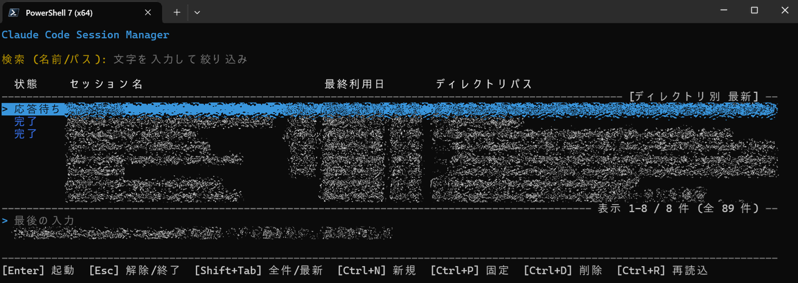
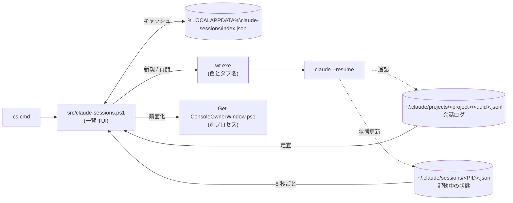

# Claude Code Session Manager

[English](README.md) | 日本語



Claude Code CLI の全セッションを一覧して絞り込み、再開できる Windows 用ランチャー。
起動中のセッションのうち、どれがユーザーの操作を待っているかも示す。

複数プロジェクトで Claude Code のセッションを並行して使っていると、どのターミナルがどの作業のものか分からなくなる。
このツールは `~/.claude/projects` 配下の全セッションを一覧表示し、選んだセッションを `claude --resume` して開く。
開いたセッションは Windows Terminal の 1 つのウィンドウにタブとして並ぶ。
タブの色とタイトルはプロジェクトごとに変わるので、どのタブが何の作業か一目で分かる。

PowerShell と Claude Code CLI しか使えない環境、たとえば追加のツールを入れられない会社 PC にお勧めする。
Windows Terminal も必要だが、Windows 11 には標準で入っている。
管理者権限は要らない。

## 特徴

- **起動中の状態表示**：起動中のセッションに `稼働中`、`応答待ち`、`完了` を表示し、5 秒ごとに更新する。
- **二重起動の防止**：起動中のセッションで `Enter` を押すと、2 つ目を開かずにそのセッションのタブに切り替えて前面に出す。
  手で起動した `claude` も対象になる (こちらはウィンドウの前面化まで)。
- **1 ウィンドウにタブで集約**：セッションごとにウィンドウを増やさず、専用のウィンドウ 1 つにタブで開く。
  設定でセッションごとに別ウィンドウで開く方式にも戻せる。
- **プロジェクト別のタブ色**：プロジェクトごとに常に同じタブ色とタイトルが付く。
  Windows Terminal のプロファイル設定は要らない。
- **ごみ箱への削除**：`Ctrl+D` はセッションをごみ箱に送るので、誤って消しても戻せる。
  起動中のセッションは削除しない。
- **インストール不要**：Windows 標準の Windows PowerShell 5.1 でも PowerShell 7 でも動くスクリプトで、clone して `cs.cmd` を実行すれば使える。
- 全プロジェクトのセッションを 1 つの画面で扱う (`claude --resume` は現在のディレクトリの分しか出さない)。
  既定ではディレクトリごとに最新のセッションだけを新しい順に並べ、隠れた古いセッションの数を `(+N)` で示す。
  `Shift+Tab` で全セッションの一覧に切り替わる。
  セッション名とパスでインクリメンタル検索でき、空白で区切った複数語は AND で絞り込む。
- `Ctrl+N` で、選択中のプロジェクトに新しいセッションを始められる。
- `Ctrl+P` で、セッションを一覧の先頭に固定できる。固定した行には `*` が付く。
- UI は日本語と英語に対応する。

## 導入

次の 3 つが必要になる。
管理者権限は要らない。

- Windows PowerShell 5.1 (Windows 10 / 11 に標準で入っている) または PowerShell 7。
  PowerShell 7 (`pwsh`) が入っていれば `cs.cmd` はそちらを使う
- Windows Terminal
- Claude Code CLI (`claude` が PATH 上にあること)

リポジトリを git clone し、フォルダ内の `cs.cmd` を実行すれば起動する。
どこからでも起動したい場合は、このフォルダを PATH に通す。

## 使い方

```powershell
.\cs.cmd
```

Git Bash からは `./cs.cmd` で起動する。

画面の言語は Windows の表示言語に合わせて日本語か英語になる。
固定したい場合は「設定」節の `Language` を変える。

初回起動時は全セッションの jsonl を走査するため数秒かかる。
2 回目以降は `%LOCALAPPDATA%\claude-sessions\index.json` のキャッシュを使うので、すぐに開く。
このキャッシュには詳細欄に出すため各セッションの最後の入力の先頭 300 文字も入るので、入力に貼った内容はここにも複製される。
ファイルは消してよく、次回起動時に作り直す。

一覧の先頭列には、起動中セッションにおける Claude Code の状態を表示する。
未起動のセッションは空欄になる。
ツールはこの状態を 5 秒ごとに読み直し、変わったときだけ描き直す。
間隔は設定の `RefreshIntervalMs` で変えられ、`0` にすると自動更新を止める。
止めた場合も、`Enter`、`Ctrl+D`、`Ctrl+R` を押したときは状態を読み直す。

一覧を開いている間に始まったセッション (`Ctrl+N` や手で起動したもの、`/clear` で ID が変わったもの) は、Claude Code が最初の発言を書き込んだ後の読み直しで一覧に加わる。
それ以外に自動で読み直すのは状態だけで、一覧そのものは読み直さない。
セッションの並び順と最終利用日は、起動時か `Ctrl+R` を押したときに一覧へ反映される。
ディレクトリ別の最新表示で、どのセッションを最新として残すかも同じタイミングで決まる。

| 表示 (英語) | 色 | 意味 |
| --- | --- | --- |
| `稼働中` (`Working`) | 緑 | Claude が処理中 (シェルコマンド実行中を含む) |
| `応答待ち` (`Waiting`) | 黄 | ツール実行の許可や質問への回答など、ユーザーの操作待ち |
| `完了` (`Done`) | 明るい青 | ターンが終わり、次の入力待ち |
| `起動中` (`Running`) | 色なし | 起動中だが状態の値が未知 (Claude Code の更新で値が変わった場合など) |

一覧の下の「最後の入力」欄には、選択中のセッションで最後に入力したプロンプトを 2 行まで表示する。
開く前に、どこまで進めた作業かを確かめられる。
画面の高さが足りないときは、この欄を出さない。

ディレクトリ別の最新表示では、検索を全セッションに対して行い、一致したものの中から作業ディレクトリごとに最新の 1 件を残す。
そのため、古いセッションの名前で検索してもそのディレクトリが見つかる。
起動中のセッションは、最新でなくても一覧に残すので、応答待ちのセッションが隠れることはない。
セッション名の後ろの `(+N)` は、そのディレクトリで検索に一致したうち表示していない件数で、`Shift+Tab` で全件表示に切り替えたときに増える行数と一致する。
一覧の下の罫線の右端には、たとえば `表示 1-20 / 30 件 (全 93 件)` と出る。
順に、画面に出ている範囲、今の表示の種類と検索語で絞り込んだ行数、全セッションの数である。

### キー操作

| キー | 動作 |
| --- | --- |
| 文字を入力 | セッション名とパスの両方で絞り込む (インクリメンタル検索)。空白区切りで複数語を打つと AND 検索になる |
| `↑` / `↓` | 絞り込み結果の中を移動 (画面外へはスクロールする) |
| `PageUp` / `PageDown` | 1 画面分移動 |
| `Home` / `End` | 先頭 / 末尾へ移動 |
| `Enter` | 選択中のセッションを再開する。起動中ならそのタブに切り替えて前面に出す。バックグラウンドで動くセッション (`claude --bg`) は `claude attach` で新しいタブに開く |
| `Shift+Tab` | ディレクトリ別の最新表示と全セッション表示を切り替える。検索語と選択中のセッションは保持する。選んでいたセッションが切替後に隠れる場合は、同じディレクトリの最新の行を選ぶ |
| `Backspace` | 検索文字を 1 文字消す |
| `Esc` | 検索をクリア。検索が空のときは 2 回続けて押すと終了する |
| `Ctrl+C` | 強制終了 |
| `Ctrl+N` | 選択中のプロジェクトで新規セッションを開始する。始めたセッションは、最初の発言から数秒後に一覧に出る |
| `Ctrl+P` | 選択中のセッションを一覧の先頭に固定する。もう一度押すと解除する。固定した行は先頭に `*` が付き、他の行より上に最終利用日の順で並ぶ。ディレクトリ別の最新表示でも隠れない |
| `Ctrl+D` | 選択中のセッションをごみ箱に移動する。`y` で確定し、それ以外のキーで取り消す。起動中のセッションは削除できない |
| `Ctrl+R` | セッション索引を再構築する (キャッシュを無視して再走査)。検索語と選択中のセッションは保持する |

## 仕組み



実線はこのツールの処理、点線は Claude Code 自身の書き込みを表す。
このツールは Claude Code のファイルを読むだけで、書き込まない (例外は `Ctrl+D` によるごみ箱送り)。

### 起動中セッションの検出

Claude Code は起動中のセッションとその状態を `~/.claude/sessions/<PID>.json` に記録している。
このツールはこれを 5 秒ごとに読み、記録ごとに実際のプロセスと突き合わせる。
異常終了で残った古い記録を、起動中と誤認しないためである。

### 二重起動の防止

同じセッションに 2 つのプロセスが書き込むと履歴が壊れるため、起動中のセッションを二重には開かない。
`Enter` と `Ctrl+D` は、実行の直前に状態を読み直す。
`Enter` で開いた直後のセッションは、状態ファイルに記録されるまで数秒かかる。
記録されるまで (最長 30 秒) は、もう一度 `Enter` を押しても「起動処理中」と表示するだけで開かず、`Ctrl+D` も削除を拒否する。
`Ctrl+N` は、同じプロジェクトへの 3 秒以内の連打を無視する。
起動中のセッションのウィンドウを前面に出せなかった場合も、新しくは開かず「既に開いています」と表示する。

### タブの特定と起動

タブ方式では、タブ名をディレクトリ名とセッション ID の先頭 8 桁にする (`claude-code-session-manager #1a2b3c4d`)。
`Enter` を押すと、このタブ名で全 Windows Terminal ウィンドウからタブを探すので、タブを別のウィンドウへ移しても見つかる。
手で `claude` を起動したウィンドウは、補助スクリプト `src/Get-ConsoleOwnerWindow.ps1` が claude のコンソールから辿って探す。
こちらは 1 秒弱かかる。

タブの色とタブ名は `wt.exe` の起動引数で渡す。
Windows Terminal のプロファイルは登録せず、`settings.json` にも一切触れない。
起動時には、Claude Code が子プロセスへ設定する環境変数 (`CLAUDE_CODE_*`、`CLAUDECODE`、`CLAUDE_PID`、`CLAUDE_EFFORT`) を取り除く。
このため、Claude Code のセッション内からこのツールを起動しても、開いたセッションが「他セッションの子」と誤認識されない。

### バックグラウンドのセッション

`claude --bg` やエージェントビューで始めたセッションはウィンドウを持たない。
`Enter` を押すと、新しいタブ (ウィンドウ方式では新しいウィンドウ) で `claude attach <jobId>` を実行する。
タブ方式では、後でもう一度 `Enter` を押すと、その attach のタブに切り替える。
`attach` はセッションを表示するだけなので、同じセッションに 2 つ目のプロセスが立つことはない。

### セッションの削除

`Ctrl+D` は、セッションの jsonl と同名フォルダ (`<uuid>\subagents` など) をごみ箱に送る。
ごみ箱から戻して `Ctrl+R` を押せば、一覧にも戻る。
`file-history` などの関連データは残すが、Claude Code の動作には影響しない。
起動中のセッションは消さない。
Claude Code はファイルが消えても追記を続けるため、消すと履歴の欠けた jsonl ができてしまう。
削除するのは `<ProjectsDir>\<プロジェクト>\<セッションID>.jsonl` の形のファイルと、その同名フォルダだけである。
なお、`ProjectsDir` をネットワーク共有などごみ箱の無いドライブに置いている場合、Windows はごみ箱を経由せず警告無しで完全に削除する。

## セッションの保持期間

一覧に出るのは Claude Code が保存している会話ログそのもので、既定では **30 日** で自動的に削除される。
長く残したい場合は `~/.claude/settings.json` に次を足す (最小 1、`3650` で約 10 年)。

```json
"cleanupPeriodDays": 3650
```

## 設定

`config.example.psd1` を同じフォルダに `config.psd1` としてコピーし、変えたい設定のコメントを外して編集する。
`config.psd1` は git の管理外なので、`git pull` で衝突しない。
書かなかった設定は既定値のまま使われる。

```powershell
@{
    Language = 'en'  # 画面の言語。'auto' (既定。Windows の表示言語に合わせる) / 'ja' / 'en'
    PageSize = 30    # 一覧に一度に表示する最大行数 (画面が低ければ自動で減らす)
}
```

`config.example.psd1` には、よく使う設定 (`Language`、`PageSize`、`LatestPerDirectory`、`WindowMode`、`RefreshIntervalMs`、`NoticeDurationMs`、`TitleMaxWidth`、`DateFormat`、`TabColors`、`ShellExe`、`StatusColors`) を載せてある。
`src/claude-sessions.ps1` 先頭の `$script:Config` にあるキーは、`ProjectsDir` などのパスも含めてすべて設定できる。
次のような設定があると、ツールは起動時にエラーで止まる。

- 知らない設定名
- 翻訳フォルダの無い `Language`
- 下限を下回る数値 (`PageSize = 0` など)
- `$true` / `$false` 以外の `LatestPerDirectory`
- `'tabs'` / `'windows'` 以外の `WindowMode`

真偽値の設定は `$` を付け、引用符で囲まずに書く。
`'false'` と書くと文字列になり、起動時に拒否される。

`config.psd1` に日本語などの非 ASCII 文字を書く場合は、BOM 付き UTF-8 で保存すること。
Windows PowerShell 5.1 は BOM の無いファイルをシステムのコードページ (日本語環境では Shift_JIS) で読むため、文字化けする。

## 言語の追加

画面の文言と状態ラベルは `src/<言語>/Messages.psd1` にあり、`Import-LocalizedData` で読み込む。
言語を追加するには、`src/en/Messages.psd1` を言語コード名のフォルダ (例: `src/de/Messages.psd1`) にコピーして値を翻訳する。
キーと `{0}` などのプレースホルダーは変えないこと (どちらもテストで確認している)。
`Language = 'auto'` なら、Windows の表示言語が `de-DE` のとき `de` フォルダが自動で使われる。
翻訳に無いキーは英語で表示する。

## テスト

Pester でテストしている。
文字列整形、検索、色決定などの純粋関数に加え、ファイルやプロセスを扱う関数の一部も対象にしている。
索引キャッシュやごみ箱送りは TestDrive 上の一時ファイルで確かめ、ウィンドウ起動は `wt.exe` 呼び出しをモックに差し替えて引数を確かめる。
キー入力ループ (`Show-SessionMenu`) と、実際に動いているプロセスの検出は対象外とした。

```powershell
./run-tests.ps1
```

インストールされている PowerShell 7 (`pwsh`) と Windows PowerShell 5.1 (`powershell`) のそれぞれでテストを実行し、どちらかが失敗すればスクリプトも失敗する。
片方だけ実行するには `-Shell pwsh` または `-Shell powershell` を付ける。

Pester 5 以降がグローバルに入っていればそれを使う。
無ければ `.tmp/modules` を探し、それも無ければ次のいずれかでインストールする。

```powershell
Install-Module -Name Pester -MinimumVersion 5.0 -Scope CurrentUser -SkipPublisherCheck
# または、プロジェクト内だけに置きたい場合
Save-Module -Name Pester -MinimumVersion 5.0 -Path .tmp/modules -Repository PSGallery
```

Windows PowerShell 5.1 に同梱の Pester は 3.4 で、古すぎて使えない。
同梱版は発行元の署名が異なるため、`Install-Module` には `-SkipPublisherCheck` が要る。
`.tmp/modules` に置いた Pester は両方の PowerShell から使われる。

## ファイル構成

```text
cs.cmd                          起動用ランチャー (PATH に通すならこのフォルダ)
config.example.psd1             config.psd1 の雛形
run-tests.ps1                   テストの実行
src/claude-sessions.ps1         本体
src/Get-ConsoleOwnerWindow.ps1  手で開いたウィンドウを前面化するための補助スクリプト (本体が別プロセスで呼ぶ)
src/en/Messages.psd1            英語の画面文言 (基準言語)
src/ja/Messages.psd1            日本語の画面文言
tests/claude-sessions.Tests.ps1 Pester テスト
```

## 既知の制約

- `~/.claude/sessions/` は Claude Code の内部ディレクトリで、公開された仕様ではない。
  将来の更新で形式が変わると、起動中の検出が効かなくなる。
  その場合は全セッションが「起動中でない」扱いになり、`Enter` を押すと前面化せずに新しく開く。
  状態の値だけが変わった場合は `起動中` と表示する。
- 手で起動したセッションの前面化は、ウィンドウの単位までにとどまる。
  同じウィンドウに複数のタブがあっても、タブは切り替えない。
  ツールで開いたタブでも、`/clear` などでセッション ID が変わった後やタブ名を手で変えた後は同じ扱いになる。
  擬似ウィンドウに所有者を設定しないターミナル (VS Code の統合ターミナルなど) で動いている場合は、ウィンドウを辿れず前面化できない。
- シンボリックリンクや subst ドライブを経由して同じフォルダを開いたセッションは、別のディレクトリとして扱う。
  最新表示では別の行になり、タブ色も別になる。
- タブ色は作業ディレクトリのパスを書かれたまま使って決める。
  大文字小文字、`/` と `\`、末尾の区切り文字だけが違うパスは、最新表示では同じ行にまとまるが、タブ色は別になることがある。
- フォーク (`--fork-session`) とコスト表示は対象外。
  フォークは `claude --resume <id> --fork-session` を直接使えば足りる。

## ライセンス

MIT。詳細は [LICENSE](LICENSE) を参照。
