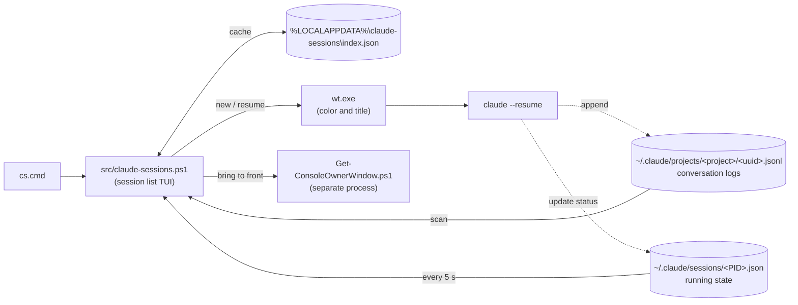

# Claude Code Session Manager

English | [日本語](README.ja.md)

A Windows launcher that lists, filters and resumes every Claude Code CLI session, and shows which running ones need you.

When you run Claude Code sessions in several projects at once, it gets hard to tell which terminal belongs to which task. This tool lists every session under `~/.claude/projects` and opens the one you pick with `claude --resume` as a tab of a single Windows Terminal window. Each project gets its own tab color and title, so you can see at a glance what every open tab is working on.

## Features

- **Live status**: Each running session shows `Working`, `Waiting` or `Done`, refreshed every 5 seconds.
- **No duplicate sessions**: Pressing `Enter` on a running session switches to its tab and brings it to the front instead of opening a second copy. This also works when `claude` was started manually (down to the window).
- **One window, one tab per session**: Sessions open as tabs of one dedicated window instead of a window each. A setting brings back a window per session.
- **Per-project tab colors**: Each project always gets the same tab color and title, with no Windows Terminal profile to set up.
- **Delete to the Recycle Bin**: `Ctrl+D` sends a session to the Recycle Bin, so a mistaken deletion can be undone. Running sessions cannot be deleted.
- **Nothing to install**: A PowerShell script that runs on the Windows PowerShell 5.1 built into Windows as well as on PowerShell 7. Clone and run `cs.cmd`.
- Sessions from every project on one screen (`claude --resume` lists only the current directory). By default it lists only the latest session of each directory, newest first, with the number of older ones as `(+N)`; `Shift+Tab` switches to every session. Incremental search covers session name and path, and space-separated words are ANDed.
- `Ctrl+N` starts a new session in the selected project.
- `Ctrl+P` pins a session to the top of the list, marked with `*`.
- The UI is in English or Japanese.

## Getting started

You need the following. Administrator rights are not needed.

- Windows PowerShell 5.1 (built into Windows 10 / 11) or PowerShell 7.4 or later. `cs.cmd` uses PowerShell 7 (`pwsh`) when it is installed
- Windows Terminal
- Claude Code CLI (`claude` on PATH)

Clone the repository and run `cs.cmd` in the folder. To launch it from anywhere, add the folder to PATH.

If you downloaded the repository as a ZIP instead of cloning it, Windows marks the scripts as downloaded from the internet and the default execution policy refuses to run them. Read through the scripts first, then unblock them once from the extracted folder:

```powershell
Get-ChildItem -Recurse | Unblock-File
```

## Usage

```powershell
.\cs.cmd
```

From Git Bash, run `./cs.cmd`.

The UI is shown in Japanese or English depending on the Windows display language. To pin it to one language, change `Language` in the "Configuration" section.

The first launch scans every session's jsonl and takes a few seconds. After that the index is cached in `%LOCALAPPDATA%\claude-sessions\index.json` and the list opens instantly. The cache also holds the first 300 characters of each session's last prompt (for the detail lines), so anything pasted into a prompt is copied there as well. Deleting the file is safe; it is rebuilt on the next launch.

The first column shows the Claude Code state of each running session. It is blank for sessions that are not running. The states are re-read every 5 seconds and the view is redrawn only when one changes. The interval is set with `RefreshIntervalMs`; `0` turns automatic refresh off. Even then, pressing `Enter`, `Ctrl+D` or `Ctrl+R` re-reads the state.

A session that starts while the list is open (with `Ctrl+N`, by hand, or under a new ID after `/clear`) is added at the next re-read, once Claude Code has written its first message. Apart from that, only the states are re-read automatically, not the list itself: the order of sessions and their last-used dates are picked up at startup or when you press `Ctrl+R`. Which session is the representative row of a directory in the latest per directory view is decided at the same times.

| Label | Color | Meaning |
| --- | --- | --- |
| `Working` | Green | Claude is processing (including running a shell command) |
| `Waiting` | Yellow | Waiting for you, such as a tool permission prompt or a question |
| `Done` | Blue | The turn has finished and Claude is waiting for the next input |
| `Running` | None | Running, but the state value is unknown (for example after a Claude Code update changed the values) |

The "Last prompt" block under the list shows up to two lines of the last prompt you typed in the selected session, so you can tell where you left off before opening it. It is hidden on a screen too short to fit it.

### Keys

| Key | Action |
| --- | --- |
| Type text | Filter by both session name and path (incremental search). Space-separated words are ANDed |
| `↑` / `↓` | Move within the filtered results (scrolls past the edge of the screen) |
| `PageUp` / `PageDown` | Move by one screen |
| `Home` / `End` | Jump to the first / last entry |
| `Enter` | Resume the selected session. If it is already running, switch to its tab and bring it to the front. A session running in the background (`claude --bg`) is opened in a new tab with `claude attach` |
| `Shift+Tab` | Switch between the latest session of each directory and every session. Keeps the search text and the selected session; if the switch hides the selected session, its directory's row is selected instead |
| `Backspace` | Delete one character of the search text |
| `Esc` | Clear the search. On an empty search, press it twice to quit |
| `Ctrl+C` | Force quit |
| `Ctrl+N` | Start a new session in the selected project. It appears in the list a few seconds after its first message |
| `Ctrl+P` | Pin the selected session to the top of the list, or unpin it. Pinned sessions show `*` at the start of the row, stay above the others in date order, and are never hidden by the latest per directory view |
| `Ctrl+D` | Move the selected session to the Recycle Bin. Press `y` to confirm, any other key to cancel. Running sessions cannot be deleted |
| `Ctrl+R` | Rebuild the session index (rescan, ignoring the cache). Keeps the search text and the selected session |

## How it works



Solid arrows are what this tool does; dotted arrows are Claude Code's own writes. The tool only reads Claude Code's files and never writes to them (the exception is sending a session to the Recycle Bin with `Ctrl+D`).

- **Session index**: Scans `~/.claude/projects/<project>/<uuid>.jsonl` one level deep (`-Recurse -Depth 1`). Subagent transcripts (`<uuid>\subagents\agent-*.jsonl`) are excluded by this depth limit. To read even 84MB logs at a practical speed, JSON parsing is kept to a minimum and most fields are extracted directly with regular expressions. The last prompt comes from the `last-prompt` records Claude Code keeps near the end of the file; in a large file only the last 128KB is searched for it, and a session whose record lies further back shows no preview.
- **Cache**: Sessions whose modification time and size match the previous run are not rescanned. If nothing changed, the cache file itself is not rewritten either. A cache written by a version that did not record the last prompt is rescanned once on the first launch after updating.
- **Launch failures**: If a session's working directory no longer exists or `wt.exe` fails to start, the tool keeps running and shows the reason on the notice line. jsonl files are opened with `FileShare.ReadWrite`, so files Claude Code is writing to do not cause sharing violations.
- **Launching**: By default (`WindowMode = 'tabs'`) each session opens as a new tab of a window named `cs` with `wt -w cs new-tab`; Windows Terminal creates the window if it does not exist. The name is set with `TabWindowName`. `WindowMode = 'windows'` opens each session in a window of its own named `cs-<session ID>`, as before. Tab color and title are passed per project directly as `wt.exe` arguments (`--title` / `--tabColor` / `-d`). In tabs mode the title also carries the first 8 characters of the session ID (`claude-code-session-manager #1a2b3c4d`) to tell tabs of one project apart, and `--suppressApplicationTitle` keeps the shell and claude from changing it. No Windows Terminal profile is registered, so even a project opened for the first time gets its color immediately. `settings.json` is never touched. The environment variables Claude Code sets for its children (`CLAUDE_CODE_*`, `CLAUDECODE`, `CLAUDE_PID` and `CLAUDE_EFFORT`) are removed at launch, so starting this tool from inside a Claude Code session does not make the new session look like a child of that session.
- **Color assignment**: The working directory path is hashed to pick a color deterministically from a fixed palette. The same project always gets the same color.
- **Detecting running sessions**: Claude Code records running sessions in `~/.claude/sessions/<PID>.json` and rewrites `status` (`busy` / `shell` / `waiting` / `idle`) whenever it changes. The tool reads these and treats records whose PID is alive as candidates. A crash can leave a stale record whose PID is later reused by another process, so the tool also compares the process start time with the record's `procStart` and counts only matching records as running.
- **Auto refresh**: Key input is not awaited with a blocking call, and the state is re-read every 5 seconds. `Enter` and `Ctrl+D` also re-read it right before deciding, regardless of the interval, so a session started since the last read is never opened a second time (two processes writing the same session). A session just opened with `Enter` takes a few seconds to record itself, so until it shows up (30 seconds at most, `LaunchGraceMs`), `Enter` on it only says it is still starting and `Ctrl+D` refuses to delete it. `Ctrl+N` on the same project within 3 seconds (`NewSessionGraceMs`) is ignored, so a double press does not open two new sessions. If the signature built from everything that determines the view (search text, selection, states of running sessions, etc.) matches the previous one, building the screen is skipped entirely. Even when it is built, an unchanged string is not written, so nothing flickers while states stay the same. Drawing moves the cursor to the top-left and overwrites instead of clearing the screen. A window resize alone is redrawn within 0.1 seconds, regardless of the refresh interval. The state files are read with .NET APIs rather than cmdlets to keep this 5-second routine light.
- **Display width**: Full-width characters take 2 columns on screen, so columns are aligned by display width rather than character count. Columns stay aligned even with Japanese session names or paths.
- **Column widths**: Session names are capped at 40 columns and all remaining space goes to the path column. Widening the window shortens the truncation of paths.
- **Search**: Matches substrings of both session name and path, ignoring case. With several space-separated words, only entries matching all of them remain. `[` and `*` are treated as literal characters. Matches are underlined rather than colored, so they are not mistaken for a status color, and when a match falls in the truncated part of a path, the visible range shifts so the match can be seen. The search line sits at the top of the screen, below the title, and the real terminal cursor always sits on it; it stays put however many sessions match. An empty search shows a gray placeholder, so it reads as an input field.
- **Latest per directory**: The search runs over every session first, and then only the newest match of each working directory is kept, so an older session's name still finds its directory. Paths that differ only in case, `/` versus `\`, or a trailing separator count as the same directory. Running sessions stay listed even when they are not the newest, so one waiting for input is never hidden; they keep their place in date order. `(+N)` after the newest row's name is the number of matching sessions of that directory left out, which is how many rows `Shift+Tab` adds for that directory. The name is shortened to keep it visible. Set `LatestPerDirectory = $false` to start with every session. The counts appear at the right end of the rule below the list and read like `Showing 1-20 of 30 (93 total)`: `1-20` is the range on screen, `30` the rows matching the current view and search, `93 total` every session. The current view (`[Latest per directory]` or `[All sessions]`) appears at the right end of the rule above the list. `Ctrl+D` in this view sends only the selected session to the Recycle Bin and keeps the rest of its directory; deleting the representative row makes the next newest session of that directory the new one.
- **Bringing tabs and windows to the front**: In tabs mode, pressing Enter on a running session searches every Windows Terminal window with UI Automation for the tab with the session's title, selects it, restores its window if minimized and brings it forward with `SetForegroundWindow`. `wt focus-tab` is not used because it only takes a tab index, which shifts when tabs are closed or reordered; searching by title also finds a tab dragged to another window. Loading UI Automation takes about 150 ms the first time, and the search about 10 ms per window. In windows mode, windows opened by this tool are named `cs-<session ID>`, and Enter brings that window to the front with `wt -w cs-<ID> focus-tab -t 0`. The tool tells whether it opened a window by checking whether the command line of claude's parent shell (pwsh or powershell) contains the session ID. Anything that neither a tab title nor a window name points to (a window where `claude` was started manually, one whose session ID changed after `/clear` etc., or a tab the user renamed) is found by walking from claude's console to its window. The helper script `src/Get-ConsoleOwnerWindow.ps1` runs as a hidden separate process, attaches to claude's console, calls `GetConsoleWindow`, and finds the Windows Terminal window (the owner of the ConPTY pseudo window) with `GetAncestor(GA_ROOTOWNER)`. Reattaching the console breaks the caller's I/O, so the main process never does it. The main process then restores the window if minimized and brings it forward with `SetForegroundWindow`. Starting the child process takes just under a second, during which key input stalls. If the window cannot be brought forward, an "already open" message appears for 3 seconds on the notice line right below the search line and no new window is opened (to avoid two processes writing the same session at once). This notice has its own line separate from the search line, so the search text never disappears and the list rows never shift while it is shown. Key input is not blocked while the notice is visible.
- **Background sessions**: A session started with `claude --bg` (or from agent view) runs without a window, so there is nothing to bring to the front. Its record in `~/.claude/sessions/` has `kind` `bg` and a short `jobId`, and Enter opens a new tab (a new window in windows mode) running `claude attach <jobId>` (`attach` takes the job ID, not the session ID). In tabs mode, pressing Enter again later switches to that attach tab. In windows mode the window is named `cs-<session ID>` as usual, so pressing Enter again adds a tab to that window; attaching only shows the session, so this never starts a second process on it. A second Enter within 3 seconds (`NewSessionGraceMs`) is ignored.
- **Deletion**: `Ctrl+D` sends the session's jsonl and the folder of the same name (`<uuid>\subagents`, etc.) to the Recycle Bin. Restoring them from the Recycle Bin and pressing `Ctrl+R` brings the session back to the list. Related data such as `file-history` is left in place; it merely loses its reference and does not affect Claude Code. Running sessions are not deleted, because Claude keeps appending even after the file is gone, leaving a jsonl with missing history. The state is read again right before deleting, so a session started while waiting for the `y` confirmation is not missed. To keep a corrupted path in the index cache from deleting an unrelated file, anything other than `<ProjectsDir>\<project>\<session ID>.jsonl` (with a GUID session ID) is refused. Items are sent to the Recycle Bin with shell32's `SHFileOperation` without dialogs, and failures are shown on the notice line (the `Microsoft.VisualBasic` API shows a GUI dialog on failure, which would stall the TUI). If `ProjectsDir` is on a drive without a Recycle Bin, such as a network share, Windows deletes the items permanently instead, without warning.
- **Pins**: Pinned session IDs are kept in `%LOCALAPPDATA%\claude-sessions\pins.json` (`PinsPath`). Only this tool reads it; Claude Code and the Desktop app know nothing of these pins. Pins of sessions no longer in the index are dropped at startup and on `Ctrl+R`, and `Ctrl+D` drops the pin of the session it deletes.
- **Progress**: The first launch and a rebuild with `Ctrl+R` actually read sessions missing from the cache, which can take from hundreds of milliseconds to a few seconds. Meanwhile `[current/total]` is shown on screen.

## Session retention

The list shows the conversation logs Claude Code itself keeps, which are deleted automatically after **30 days** by default. To keep them longer, add the following to `~/.claude/settings.json` (minimum 1; `3650` is about 10 years).

```json
"cleanupPeriodDays": 3650
```

## Configuration

Copy `config.example.psd1` to `config.psd1` in the same folder and uncomment the settings you want to change. `config.psd1` is ignored by git, so `git pull` never conflicts with it. Settings you leave out keep their defaults.

```powershell
@{
    Language = 'en'  # UI language: 'auto' (default, follows the Windows display language), 'ja' or 'en'
    PageSize = 30    # Maximum rows shown at once (reduced automatically on short screens)
}
```

`config.example.psd1` lists the common settings: `Language`, `PageSize`, `LatestPerDirectory`, `WindowMode`, `RefreshIntervalMs`, `NoticeDurationMs`, `TitleMaxWidth`, `DateFormat`, `TabColors`, `ShellExe` and `StatusColors`. Every key of `$script:Config` at the top of `src/claude-sessions.ps1` can be set, including paths such as `ProjectsDir`. The tool stops with an error at startup on an unknown setting name, a `Language` that has no translation folder, a number below its lower bound (such as `PageSize = 0`), a `LatestPerDirectory` other than `$true` / `$false`, or a `WindowMode` other than `'tabs'` / `'windows'`. Write booleans with the `$` and without quotes: `'false'` is a string and is rejected.

If `config.psd1` contains non-ASCII text, save it as UTF-8 with BOM. Windows PowerShell 5.1 reads a file without a BOM in the system code page, so the text would be garbled.

## Adding a language

The UI text and status labels are in `src/<language>/Messages.psd1`, loaded with `Import-LocalizedData`. To add a language, copy `src/en/Messages.psd1` to a folder named after the language code (for example `src/de/Messages.psd1`) and translate the values. Keep the keys and the `{0}` placeholders as they are; the tests check both. With `Language = 'auto'`, a Windows display language such as `de-DE` picks up the `de` folder automatically. Keys missing from a translation fall back to English.

## Tests

Tests use Pester. Besides pure functions (string formatting, search, color selection, etc.), some functions that handle files or processes are covered: the index cache and sending to the Recycle Bin are checked with temporary files on TestDrive, and window launching by replacing the `wt.exe` call with a mock and checking its arguments. The key input loop (`Show-SessionMenu`) and detection of actually running processes are not covered.

```powershell
./run-tests.ps1
```

The tests run once on each installed PowerShell, PowerShell 7 (`pwsh`) and Windows PowerShell 5.1 (`powershell`), and the script fails if either fails. `-Shell pwsh` or `-Shell powershell` runs only one of them.

Pester 5 or later is used if installed globally. Otherwise the script looks in `.tmp/modules`, and if it is not there either, install it with one of these:

```powershell
Install-Module -Name Pester -MinimumVersion 5.0 -Scope CurrentUser -SkipPublisherCheck
# Or, to keep it inside the project only
Save-Module -Name Pester -MinimumVersion 5.0 -Path .tmp/modules -Repository PSGallery
```

Windows PowerShell 5.1 comes with Pester 3.4, which is too old. `-SkipPublisherCheck` is needed because that built-in copy is signed by a different publisher. Pester in `.tmp/modules` is shared by both PowerShell versions.

## Files

```text
cs.cmd                          Launcher (add this folder to PATH if you like)
config.example.psd1             Template for your config.psd1
run-tests.ps1                   Runs the tests
src/claude-sessions.ps1         Main script
src/Get-ConsoleOwnerWindow.ps1  Helper for focusing manually opened windows (run by the main script as a separate process)
src/en/Messages.psd1            English UI text (reference language)
src/ja/Messages.psd1            Japanese UI text
tests/claude-sessions.Tests.ps1 Pester tests
```

## Known limitations

- `~/.claude/sessions/` is an internal Claude Code directory, not a public spec. If a future update changes its format, running-session detection stops working (every session is then treated as not running and opened anew). If only the state values change, the session is shown as `Running`.
- Focusing a manually started session works only down to the window. If the window has several tabs, the tab is not switched. The same goes for a tab opened by this tool once its session ID changes (`/clear` etc.) or the user renames it. In terminals that set no owner on the pseudo window (such as the VS Code integrated terminal), the window cannot be found and focusing fails.
- Sessions opened in the same folder through a symbolic link or a `subst` drive count as different directories: they get separate rows in the latest per directory view and different tab colors.
- Forking (`--fork-session`) and cost display are out of scope. For forking, running `claude --resume <id> --fork-session` directly is enough.

## License

MIT. See [LICENSE](LICENSE) for details.
