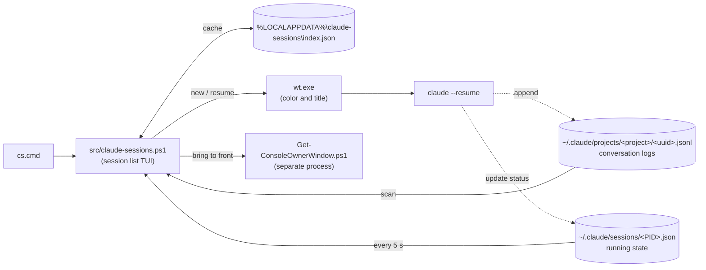

# Claude Code Session Manager

English | [日本語](README.ja.md)

A Windows launcher that lists, filters and resumes every Claude Code CLI session, and shows which running ones need you.

When you run Claude Code sessions in several projects at once, it gets hard to tell which terminal belongs to which task. This tool lists every session under `~/.claude/projects` and opens the one you pick with `claude --resume` as a tab of a single Windows Terminal window. Each project gets its own tab color and title, so you can see at a glance what every open tab is working on.

Recommended for locked-down machines, such as a work PC, where PowerShell and Claude Code CLI are all you can use. It also needs Windows Terminal, which comes with Windows 11. No administrator rights are required.

## Features

- **Live status**: Each running session shows `Working`, `Waiting` or `Done`, refreshed every 5 seconds.
- **No duplicate sessions**: Pressing `Enter` on a running session switches to its tab and brings it to the front instead of opening a second copy. This also works when `claude` was started manually (down to the window).
- **One window, one tab per session**: Sessions open as tabs of one dedicated window instead of a window each. A setting brings back a window per session.
- **Per-project tab colors**: Each project always gets the same tab color and title, with no Windows Terminal profile to set up.
- **Delete to the Recycle Bin**: `Ctrl+D` sends a session to the Recycle Bin, so a mistaken deletion can be undone. Running sessions cannot be deleted.
- **Nothing to install**: A PowerShell script that runs on the Windows PowerShell 5.1 built into Windows as well as on PowerShell 7. Clone and run `cs.cmd`.
- Sessions from every project on one screen (`claude --resume` lists only the current directory). By default it lists only the latest session of each directory, newest first, with the number of older ones as `(+N)`; `Shift+Tab` switches to every session. Incremental search covers session name and path, and space-separated words are ANDed.
- `Ctrl+N` starts a new session in the selected project.
- `Ctrl+P` pins a session to the top of the list, marked with `*`.
- The UI is in English or Japanese.

## Getting started

You need the following. Administrator rights are not needed.

- Windows PowerShell 5.1 (built into Windows 10 / 11) or PowerShell 7. `cs.cmd` uses PowerShell 7 (`pwsh`) when it is installed
- Windows Terminal
- Claude Code CLI (`claude` on PATH)

Clone the repository and run `cs.cmd` in the folder. To launch it from anywhere, add the folder to PATH.

## Usage

```powershell
.\cs.cmd
```

From Git Bash, run `./cs.cmd`.

The UI is shown in Japanese or English depending on the Windows display language. To pin it to one language, change `Language` in the "Configuration" section.

The first launch scans every session's jsonl and takes a few seconds. After that the index is cached in `%LOCALAPPDATA%\claude-sessions\index.json` and the list opens instantly. The cache also holds the first 300 characters of each session's last prompt (for the detail lines), so anything pasted into a prompt is copied there as well. Deleting the file is safe; it is rebuilt on the next launch.

The first column shows the Claude Code state of each running session. It is blank for sessions that are not running. The states are re-read every 5 seconds and the view is redrawn only when one changes. The interval is set with `RefreshIntervalMs`; `0` turns automatic refresh off. Even then, pressing `Enter`, `Ctrl+D` or `Ctrl+R` re-reads the state.

A session that starts while the list is open (with `Ctrl+N`, by hand, or under a new ID after `/clear`) is added at the next re-read, once Claude Code has written its first message. Apart from that, only the states are re-read automatically, not the list itself: the order of sessions and their last-used dates are picked up at startup or when you press `Ctrl+R`. Which session the latest per directory view keeps for each directory is decided at the same times.

| Label | Color | Meaning |
| --- | --- | --- |
| `Working` | Green | Claude is processing (including running a shell command) |
| `Waiting` | Yellow | Waiting for you, such as a tool permission prompt or a question |
| `Done` | Bright blue | The turn has finished and Claude is waiting for the next input |
| `Running` | None | Running, but the state value is unknown (for example after a Claude Code update changed the values) |

The "Last prompt" block under the list shows up to two lines of the last prompt you typed in the selected session, so you can tell where you left off before opening it. It is hidden on a screen too short to fit it.

In the latest per directory view, the search runs over every session first and then keeps the newest match of each working directory, so an older session's name still finds its directory. Running sessions stay listed even when they are not the newest, so one waiting for input is never hidden. `(+N)` after a name is the number of matching sessions of that directory left out, which is how many rows `Shift+Tab` adds for it. The counts at the right end of the rule below the list read like `Showing 1-20 of 30 (93 total)`: the range on screen, the rows matching the current view and search, and every session.

### Keys

| Key | Action |
| --- | --- |
| Type text | Filter by both session name and path (incremental search). Space-separated words are ANDed |
| `↑` / `↓` | Move within the filtered results (scrolls past the edge of the screen) |
| `PageUp` / `PageDown` | Move by one screen |
| `Home` / `End` | Jump to the first / last entry |
| `Enter` | Resume the selected session. If it is already running, switch to its tab and bring it to the front. A session running in the background (`claude --bg`) is opened in a new tab with `claude attach` |
| `Shift+Tab` | Switch between the latest session of each directory and every session. Keeps the search text and the selected session; if the switch hides the selected session, its directory's row is selected instead |
| `Backspace` | Delete one character of the search text |
| `Esc` | Clear the search. On an empty search, press it twice to quit |
| `Ctrl+C` | Force quit |
| `Ctrl+N` | Start a new session in the selected project. It appears in the list a few seconds after its first message |
| `Ctrl+P` | Pin the selected session to the top of the list, or unpin it. Pinned sessions show `*` at the start of the row, stay above the others in date order, and are never hidden by the latest per directory view |
| `Ctrl+D` | Move the selected session to the Recycle Bin. Press `y` to confirm, any other key to cancel. Running sessions cannot be deleted |
| `Ctrl+R` | Rebuild the session index (rescan, ignoring the cache). Keeps the search text and the selected session |

## How it works



Solid arrows are what this tool does; dotted arrows are Claude Code's own writes. The tool only reads Claude Code's files and never writes to them (the exception is sending a session to the Recycle Bin with `Ctrl+D`).

### Detecting running sessions

Claude Code records each running session and its state in `~/.claude/sessions/<PID>.json`. The tool reads these every 5 seconds and checks each record against the live process, so a stale record left by a crash is not mistaken for a running session.

### Preventing double launches

Two processes writing the same session would corrupt its history, so the tool never opens a running session a second time. `Enter` and `Ctrl+D` re-read the state right before acting. A session just opened with `Enter` takes a few seconds to record itself; until it does (30 seconds at most), `Enter` on it only says it is still starting and `Ctrl+D` refuses to delete it. `Ctrl+N` on the same project within 3 seconds is ignored. If the window of a running session cannot be brought to the front, the tool says it is already open instead of opening it again.

### Finding and launching tabs

In tabs mode each tab is titled with the directory name and the first 8 characters of the session ID (`claude-code-session-manager #1a2b3c4d`), and `Enter` finds the tab by that title in every Windows Terminal window, even after it is dragged to another window. A window where `claude` was started by hand is found from claude's console by the helper `src/Get-ConsoleOwnerWindow.ps1`, which takes just under a second.

Tab color and title are passed as `wt.exe` arguments. No Windows Terminal profile is registered and `settings.json` is never touched. The environment variables Claude Code sets for its children (`CLAUDE_CODE_*`, `CLAUDECODE`, `CLAUDE_PID` and `CLAUDE_EFFORT`) are removed at launch, so starting this tool from inside a Claude Code session does not make the new session look like a child of that session.

### Background sessions

A session started with `claude --bg` (or from agent view) has no window. `Enter` opens a new tab (a new window in windows mode) running `claude attach <jobId>`, and in tabs mode a later `Enter` switches to that tab. Attaching only shows the session, so it never starts a second process on it.

### Deleting sessions

`Ctrl+D` sends the session's jsonl and the folder of the same name (`<uuid>\subagents`, etc.) to the Recycle Bin. Restoring them and pressing `Ctrl+R` brings the session back. Related data such as `file-history` is left in place and does not affect Claude Code. Running sessions are refused, because Claude keeps appending after the file is gone and leaves a jsonl with missing history. The tool deletes nothing but a `<ProjectsDir>\<project>\<session ID>.jsonl` file and its folder of the same name. If `ProjectsDir` is on a drive without a Recycle Bin, such as a network share, Windows deletes the items permanently, without warning.

## Session retention

The list shows the conversation logs Claude Code itself keeps, which are deleted automatically after **30 days** by default. To keep them longer, add the following to `~/.claude/settings.json` (minimum 1; `3650` is about 10 years).

```json
"cleanupPeriodDays": 3650
```

## Configuration

Copy `config.example.psd1` to `config.psd1` in the same folder and uncomment the settings you want to change. `config.psd1` is ignored by git, so `git pull` never conflicts with it. Settings you leave out keep their defaults.

```powershell
@{
    Language = 'en'  # UI language: 'auto' (default, follows the Windows display language), 'ja' or 'en'
    PageSize = 30    # Maximum rows shown at once (reduced automatically on short screens)
}
```

`config.example.psd1` lists the common settings: `Language`, `PageSize`, `LatestPerDirectory`, `WindowMode`, `RefreshIntervalMs`, `NoticeDurationMs`, `TitleMaxWidth`, `DateFormat`, `TabColors`, `ShellExe` and `StatusColors`. Every key of `$script:Config` at the top of `src/claude-sessions.ps1` can be set, including paths such as `ProjectsDir`. The tool stops with an error at startup on any of the following:

- An unknown setting name
- A `Language` that has no translation folder
- A number below its lower bound (such as `PageSize = 0`)
- A `LatestPerDirectory` other than `$true` / `$false`
- A `WindowMode` other than `'tabs'` / `'windows'`

Write booleans with the `$` and without quotes: `'false'` is a string and is rejected.

If `config.psd1` contains non-ASCII text, save it as UTF-8 with BOM. Windows PowerShell 5.1 reads a file without a BOM in the system code page, so the text would be garbled.

## Adding a language

The UI text and status labels are in `src/<language>/Messages.psd1`, loaded with `Import-LocalizedData`. To add a language, copy `src/en/Messages.psd1` to a folder named after the language code (for example `src/de/Messages.psd1`) and translate the values. Keep the keys and the `{0}` placeholders as they are; the tests check both. With `Language = 'auto'`, a Windows display language such as `de-DE` picks up the `de` folder automatically. Keys missing from a translation fall back to English.

## Tests

Tests use Pester. Besides pure functions (string formatting, search, color selection, etc.), some functions that handle files or processes are covered: the index cache and sending to the Recycle Bin are checked with temporary files on TestDrive, and window launching by replacing the `wt.exe` call with a mock and checking its arguments. The key input loop (`Show-SessionMenu`) and detection of actually running processes are not covered.

```powershell
./run-tests.ps1
```

The tests run once on each installed PowerShell, PowerShell 7 (`pwsh`) and Windows PowerShell 5.1 (`powershell`), and the script fails if either fails. `-Shell pwsh` or `-Shell powershell` runs only one of them.

Pester 5 or later is used if installed globally. Otherwise the script looks in `.tmp/modules`, and if it is not there either, install it with one of these:

```powershell
Install-Module -Name Pester -MinimumVersion 5.0 -Scope CurrentUser -SkipPublisherCheck
# Or, to keep it inside the project only
Save-Module -Name Pester -MinimumVersion 5.0 -Path .tmp/modules -Repository PSGallery
```

Windows PowerShell 5.1 comes with Pester 3.4, which is too old. `-SkipPublisherCheck` is needed because that built-in copy is signed by a different publisher. Pester in `.tmp/modules` is shared by both PowerShell versions.

## Files

```text
cs.cmd                          Launcher (add this folder to PATH if you like)
config.example.psd1             Template for your config.psd1
run-tests.ps1                   Runs the tests
src/claude-sessions.ps1         Main script
src/Get-ConsoleOwnerWindow.ps1  Helper for focusing manually opened windows (run by the main script as a separate process)
src/en/Messages.psd1            English UI text (reference language)
src/ja/Messages.psd1            Japanese UI text
tests/claude-sessions.Tests.ps1 Pester tests
```

## Known limitations

- `~/.claude/sessions/` is an internal Claude Code directory, not a public spec. If a future update changes its format, running-session detection stops working (every session is then treated as not running and opened anew). If only the state values change, the session is shown as `Running`.
- Focusing a manually started session works only down to the window. If the window has several tabs, the tab is not switched. The same goes for a tab opened by this tool once its session ID changes (`/clear` etc.) or the user renames it. In terminals that set no owner on the pseudo window (such as the VS Code integrated terminal), the window cannot be found and focusing fails.
- Sessions opened in the same folder through a symbolic link or a `subst` drive count as different directories: they get separate rows in the latest per directory view and different tab colors.
- Tab colors are picked from the working directory path as written. Paths that differ only in case, `/` versus `\`, or a trailing separator share a row in the latest per directory view, but can still get different tab colors.
- Forking (`--fork-session`) and cost display are out of scope. For forking, running `claude --resume <id> --fork-session` directly is enough.

## License

MIT. See [LICENSE](LICENSE) for details.
